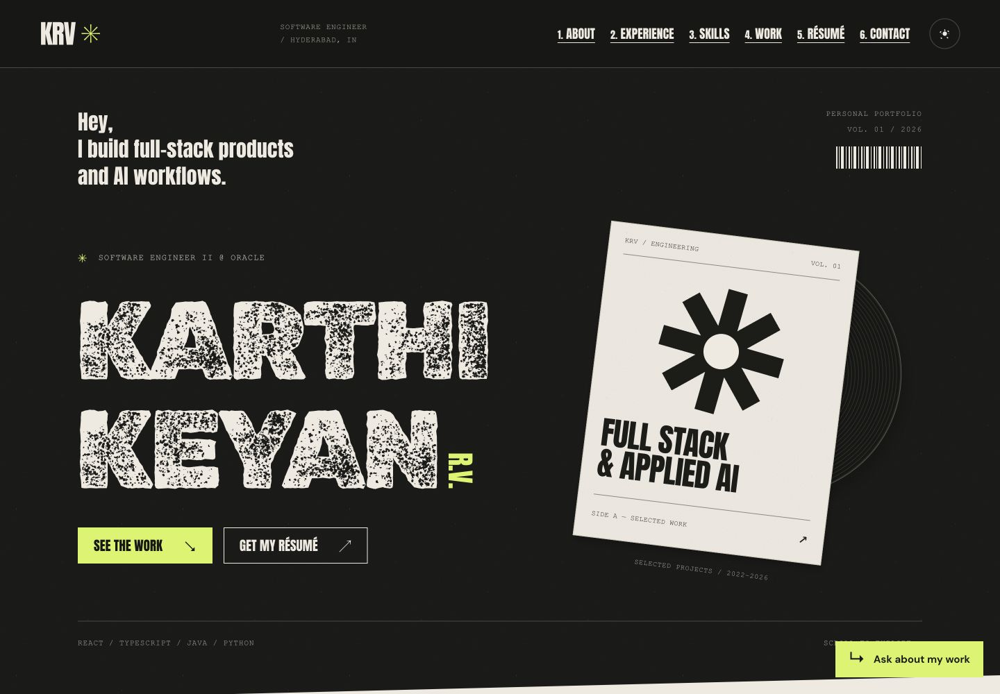
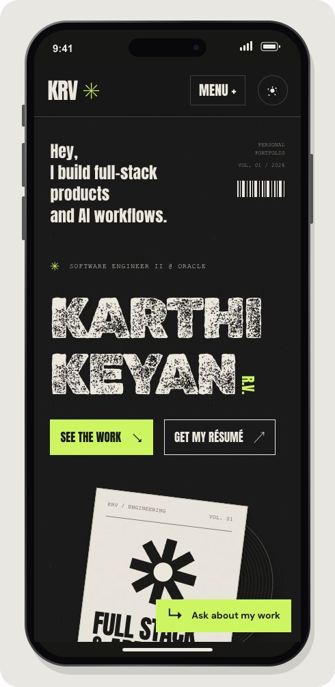
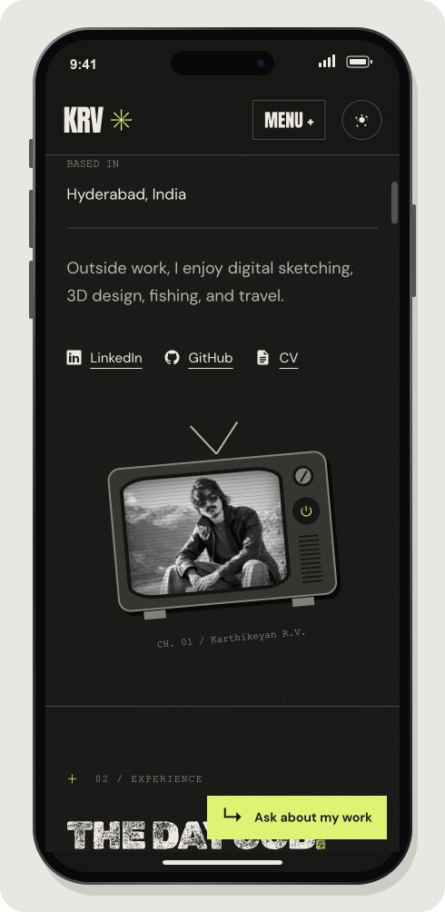
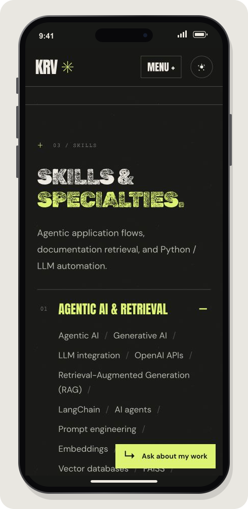
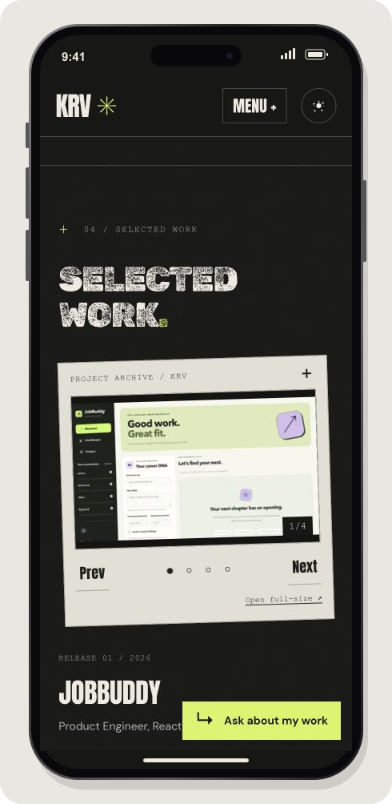
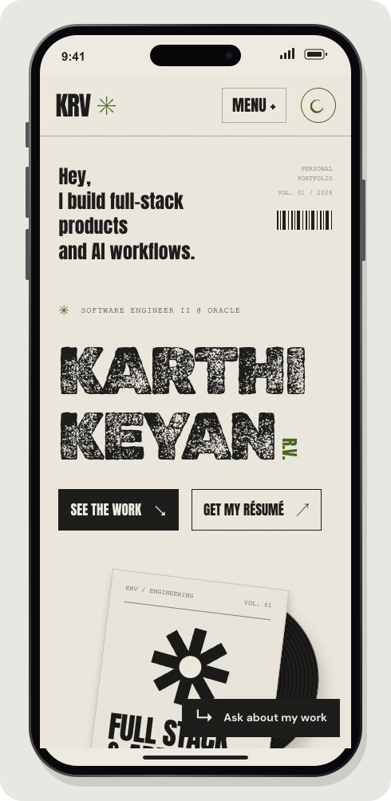
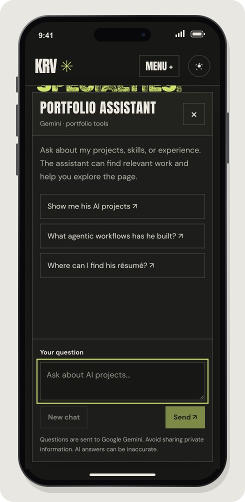

# Karthikeyan R. V. — Portfolio

A Next.js / React portfolio with a grunge print aesthetic: distressed headlines, record-sleeve artwork, charcoal and paper themes, a small interactive television portrait, and a Gemini-powered portfolio assistant.

**[Live portfolio](https://karthikeyan-r-v-portfolio.netlify.app)** · Built with Next.js, React, and TypeScript. This is a responsive web application, available directly in a mobile browser.

## Desktop preview



## Mobile walkthrough

Screenshots of the redesigned application at a 390 × 844 CSS-pixel viewport, presented in illustrative iPhone-style frames. These are mobile browser captures, not a native iOS app. Open any image for a larger view.

<table>
  <tr>
    <th>Home</th>
    <th>About</th>
    <th>AI skills</th>
  </tr>
  <tr>
    <td><a href="docs/screenshots/mobile-home-iphone.png"></a></td>
    <td><a href="docs/screenshots/mobile-about-iphone.png"></a></td>
    <td><a href="docs/screenshots/mobile-skills-iphone.png"></a></td>
  </tr>
  <tr>
    <th>Project gallery</th>
    <th>Paper theme</th>
    <th>Portfolio assistant</th>
  </tr>
  <tr>
    <td><a href="docs/screenshots/mobile-projects-iphone.png"></a></td>
    <td><a href="docs/screenshots/mobile-light-iphone.png"></a></td>
    <td><a href="docs/screenshots/mobile-chat-iphone.png"></a></td>
  </tr>
</table>

Try the flow: **See the work** → browse project screenshots → open **Ask about my work** → ask **Show me his AI projects**. The assistant can return sources and a button to the relevant project. The header also links to experience, skills, the résumé, and contact details; the theme button switches between light and dark. The chat screenshot shows the initial interface; live answers depend on provider availability and quota.

## Design and type

The visual direction is inspired by [Grunge on ThemeWagon](https://preview.themewagon.com/grunge/). The layout, record artwork, and texture are implemented for this portfolio; no template code or assets are copied.

Fonts are hosted locally through `next/font/local`: [Anton](src/app/fonts/anton-OFL.txt) for condensed display type, [Rubik Dirt](src/app/fonts/rubikdirt-OFL.txt) for distressed headlines, and [DM Sans](src/app/fonts/dmsans-OFL.txt) for body copy. The linked SIL Open Font License files are included alongside the fonts.

## Run locally

```bash
npm ci
cp .env.example .env.local
npm run dev
```

Add your Gemini API key to `GEMINI_API_KEY` in `.env.local`. Never use a `NEXT_PUBLIC_` prefix or commit that file. The template is safe to commit; real environment files remain ignored. Restart the server after changing environment values. Open [localhost:3000](http://localhost:3000).

## Portfolio assistant

The **Ask about my work** button opens the chat. The model can:

- Search actual skills, experience, projects, and education from the portfolio JSON files.
- Select a section or project and offer a button that scrolls to and highlights it.
- Offer the current résumé PDF.
- Answer follow-up questions within a five-question conversation.

Example: **Show me his AI projects** → server retrieves matching portfolio records → Gemini can call `search_portfolio` for more evidence → calls `prepare_project_link` → answers with source references and a **View Vortex AI** button. Navigation occurs when the visitor clicks the button. Workflow details show executed tool names, not hidden model reasoning.

This uses real Gemini inference through a server-side API route. It is not a canned chatbot. When no key is configured, it explicitly shows an offline state with working portfolio links. Conversations stay in page memory and clear on reload; each submitted conversation is sent to Google Gemini. No analytics or server-side conversation storage is added. Avoid submitting private information. Google's free-tier data terms apply.

### Configuration and free-tier use

Default model: `gemini-3.1-flash-lite`. `GEMINI_MODEL` can select another compatible text/function-calling Gemini model available to your project. No automatic model fallback, paid grounding/search, embeddings service, vector database, or new runtime dependency is used.

The model is listed with free input/output tokens for eligible projects in [Google's pricing documentation](https://ai.google.dev/gemini-api/docs/pricing#gemini-3.1-flash-lite). Free access and quotas depend on your Google project and can change. To keep model API charges at zero, use a project that remains on Google's Free tier. This code cannot enforce your Google billing configuration or guarantee free hosting.

Application safeguards:

- Maximum 1,200 characters per question, nine messages per request, and 10,000 history characters.
- Maximum four model calls and six tool calls per question, with a 25-second server timeout.
- At most 1,400 output tokens per model call.
- Best-effort limits of eight chat requests per minute, two concurrent requests, and 60 model calls per UTC day **per running server process**.
- Model calls count toward limits even if the provider rejects them. No automatic retries on quota errors.
- Validated tool arguments; page navigation is restricted to known sections and project IDs. No arbitrary URL fetching, code execution, email sending, or form submission.
- Plain-text/limited inline formatting rendered through React, never raw model HTML.

The in-memory counters reset on process restarts and do not coordinate across serverless instances. They are protective throttles, **not a deployment-wide spending cap**. Provider project quotas are the backstop; a public site with substantial traffic should add a shared rate-limit store and abuse protection before increasing quotas.

Set `PORTFOLIO_CHAT_ENABLED=false` to turn inference off. No keys or raw provider errors are returned by the API.

### Deploy

Use a Node-capable Next.js host, such as Vercel or a server running `npm run build && npm start`. Add the same server-side environment values in the host's settings and redeploy. The assistant and contact form require server-side API routes; static-only hosting cannot run them. Hosting plan limits are separate from Gemini limits.

## Content

- `src/app/data/skills.json`: grouped skills; AI and retrieval appear first.
- `src/app/data/project.json`: project descriptions and galleries.
- `src/app/data/experience.json`: employment history.
- `src/app/data/resume.json`: education, certifications, and résumé content.
- `public/KarthikeyanRV_Resume.pdf`: downloadable résumé.
- `src/app/data/site.json`: `showBlogs` temporarily disables Blogs without deleting its content.

The contact form separately requires `EMAIL_USER` and `EMAIL_PASS` for the existing Gmail transport.

## Validation

```bash
npm run lint
npm run test:chat
npm run build -- --webpack
```

Webpack is available for environments where Turbopack workers cannot bind their internal ports. Tests use controlled provider responses; live validation additionally requires a valid Gemini key and remaining provider quota.
